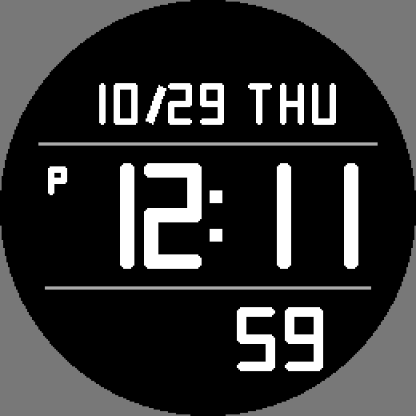

# LCD Block — циферблат для Garmin Fenix 6

Циферблат в стиле цифровых LCD-часов: сплошные цифры, дата и день недели сверху,
время в блоке между двумя линиями, секунды снизу.



- Формат времени берётся из настроек часов. В 12-часовом режиме после полудня слева от времени горит «P».
- Ведущий ноль у часов, месяца и дня не показывается (как на LCD-часах).
- В режиме сна секунды обновляются каждую секунду (частичная перерисовка).

## Запуск в симуляторе

1. Открой папку репозитория в VS Code (нужно расширение Monkey C и Connect IQ SDK).
2. `Ctrl+Shift+P` → **Monkey C: Build for Device** или **Run** → выбери `fenix6`.
3. Если VS Code просит ключ разработчика: `Ctrl+Shift+P` → **Monkey C: Generate a Developer Key**.

## Структура

```
manifest.xml             описание приложения (тип watchface, устройства)
monkey.jungle            конфигурация сборки
source/
  LcdBlockApp.mc         точка входа
  LcdBlockView.mc        отрисовка: раскладка, символы, рисование
resources/
  drawables/             иконка приложения
  strings/               строки
tools/
  preview.py             рисует docs/preview.png и иконку той же геометрией, что на часах
```

## Как устроены символы

Шрифтов нет: каждый символ — набор штрихов (`_glyphs` в `LcdBlockView.mc`), которые рисуются
прямоугольниками со скруглёнными углами. Размеры и толщина штриха задаются константами
раскладки в начале `LcdBlockView.mc` (`DATE_*`, `TIME_*`, `SEC_*`).

Если меняешь раскладку или символы, поправь те же числа в `tools/preview.py` и пересобери превью:

```
pip install pillow
python3 tools/preview.py
```
